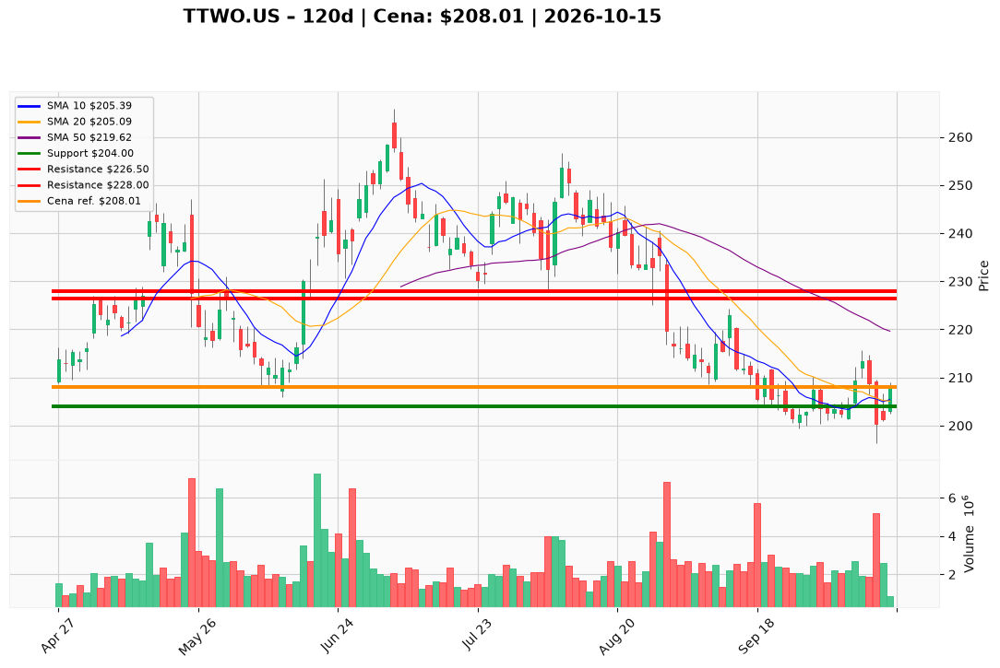

# TTWO.US — Ticket posiadacza (2026-10-15)

**Werdykt:** HOLD
**Horyzont:** swing (dni–tygodnie)
**Cena ref.:** $208.01

**Pozycja zapisana (TTWO.US):** wejście **$253.29**; SL **$204.00**; TP1 **$226.50**; TP2 **$228.00**.  
P/L vs $208.01: **−$45.28 (−17,9%)**.

| | Poziom | Uwagi |
|---|--------|------|
| **Akcja teraz** | trzymaj | bez dokupu; utrzymaj twardy SL $204 po odbiciu z dołka 13.10 ($200.32) |
| **Stop-loss** | $204.00 | twardy; wyjście przy close < $204 |
| **TP1** | $226.50 | redukcja części (strefa 50 SMA ~$220) |
| **TP2** | $228.00 | wyjście reszty / górny kraniec swing |

**Sizing / skala:** 0% nowego kapitału. Trzymaj pełny lot. Ryzyko od $208.01 do $204 ≈ 1,9%. Nie dokupuj — cena pod 50/200 SMA, odbicie 15.10 na niskim wolumenie (~878k vs 5,2M na dołku).

**Warunek dokupu:** Brak. Add dopiero po zamknięciu na wolumenie >2,5M powyżej **$215.00** (nie dotyczy lotu −17,9% pod wodą).

**Unieważnienie / pełne wyjście:** Close < **$204.00** → wyjście 100% na market. Brak reclaim **$212** w ciągu ~5 sesji + ponowne zejście pod $204 → abort bez czekania.

**Dlaczego (1–2 zdania):** PM Hold: lot przy $253.29 jest −17,9% pod wodą, ale strefa $200–204 utrzymała się po kapitalizacji 13.10, histogram MACD dodatni (+1,08) i cena nad 10 EMA — warunkowy hold ze SL $204 i celami $226,50/$228. Insiderzy sprzedawali ~$200–220; bez dokupu do potwierdzenia trendu.

**WERDYKT KOŃCOWY:** HOLD — trzymaj lot TTWO.US (wejście $253.29, P/L −17,9%) ze SL $204.00, TP1 $226.50 / TP2 $228.00; bez dokupu, wyjście przy close < $204.

