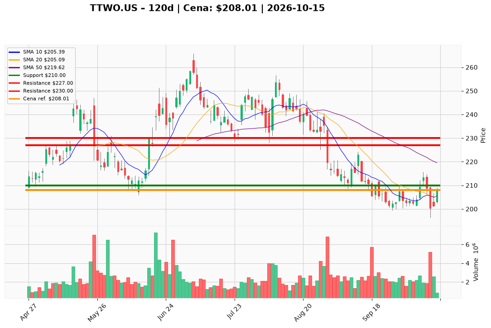

# TTWO.US — Ticket posiadacza (2026-10-15)

**Werdykt:** HOLD
**Horyzont:** swing (dni–tygodnie)
**Cena ref.:** $208.01

**Pozycja zapisana (TTWO.US#3):** wejście **$221.00**; SL **$210.00**; TP1 **$227.00**; TP2 **$230.00**.  
P/L vs $208.01: **−$12.99 (−5,9%)**.

| | Poziom | Uwagi |
|---|--------|------|
| **Akcja teraz** | trzymaj | bez dokupu; odbicie po dołku 13.10 ($196.30), cena nad 10 EMA ~$205.6 |
| **Stop-loss** | $210.00 | twardy; wyjście przy close < $210 |
| **TP1** | $227.00 | redukcja części (strefa 50 SMA / swing) |
| **TP2** | $230.00 | wyjście reszty |

**Sizing / skala:** 0% nowego kapitału. Pełny lot #3; ryzyko ~5% od wejścia do SL.

**Warunek dokupu:** Brak. Add dopiero po zamknięciu > **$215.00** na wolumenie >2M (potwierdzenie wyjścia z breakdownu).

**Unieważnienie / pełne wyjście:** Close < $210.00 lub nowy dołek < $196.30 → pełne wyjście (nie uśredniaj).

**Dlaczego (1–2 zdania):** PM Hold: po gwałtownym spadku 13.10 histogram MACD jest dodatni i cena wróciła nad 10 EMA/VWMA, ale trend średnioterminowy nadal pod 50/200 SMA — utrzymaj SL $210 i cele $227/$230 bez dokupu.

**WERDYKT KOŃCOWY:** HOLD — trzymaj lot TTWO.US#3 (wejście $221.00, P/L −5,9%) ze SL $210.00, TP1 $227.00 / TP2 $230.00; bez dokupu, wyjście przy close < $210.

