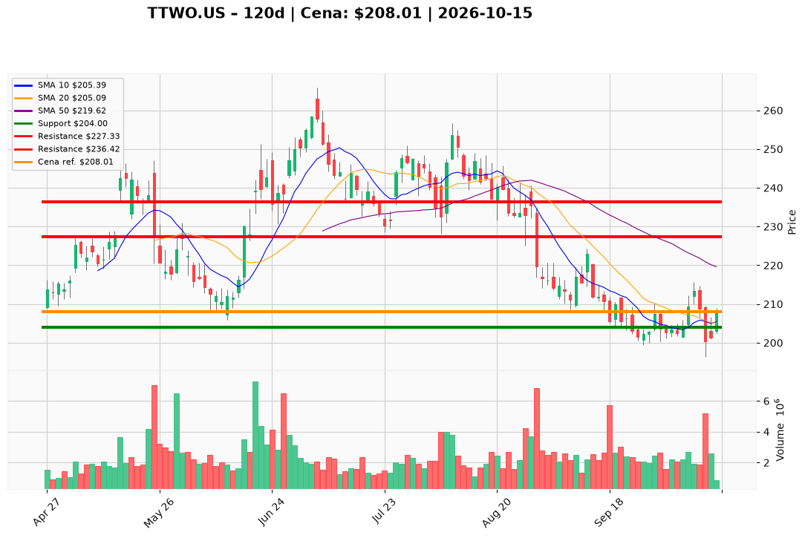

# TTWO.US — Ticket posiadacza (2026-10-15)

**Werdykt:** HOLD
**Horyzont:** swing (dni–tygodnie)
**Cena ref.:** $208.01

**Pozycja zapisana (TTWO.US#2):** wejście **$231.49**; SL **$204.00**; TP1 **$227.33**; TP2 **$236.42**.  
P/L vs $208.01: **−$23.48 (−10,1%)**.

| | Poziom | Uwagi |
|---|--------|------|
| **Akcja teraz** | trzymaj | bez dokupu; odbicie po flushu do $196.30 — czekaj na reclaim $213+ na wolumenie |
| **Stop-loss** | $204.00 | twardy (poniżej strefy $204–$207 i pivotów z początku października); wyjście przy close < $204 |
| **TP1** | $227.33 | redukcja części (strefa 50 SMA ~$220–$227) |
| **TP2** | $236.42 | wyjście reszty / odzyskanie powyżej kosztu |

**Sizing / skala:** 0% nowego kapitału. Trzymaj pełny lot #2. Ryzyko do SL ~11,8% od wejścia ($231.49 → $204) — nie dokładaj w głąb straty.

**Warunek dokupu:** Brak. Add tylko po zamknięciu > **$213.00** na wolumenie >2M (potwierdzenie przełamania po breakdownie 13.10).

**Unieważnienie / pełne wyjście:** Close < **$204.00** → pełne wyjście ze stopa. Dodatkowo: close < **$196.30** (dołek 13.10) na wolumenie → natychmiastowy exit bez czekania. Brak reclaim $213 w ciągu 5 sesji przy słabnięciu w kierunku $204 → rozważ redukcję (monitoring).

**Dlaczego (1–2 zdania):** PM **Hold**: po kapitalizacji sprzedaży 13.10 cena wróciła nad 10 EMA ($205.61), histogram MACD jest dodatni (+1.08), ale struktura nadal pod 50/200 SMA (~$220–$223) i TTM EPS ujemny — bez sensu dokup przy −10% P/L. Cele $227/$236 zgodne z planem swing; SL $204 chroni przed ponownym testem dołka $196.

**WERDYKT KOŃCOWY:** HOLD — trzymaj lot TTWO.US#2 (wejście $231.49, P/L −10,1%) ze SL $204.00, TP1 $227.33 / TP2 $236.42; bez dokupu, wyjście przy close < $204.

