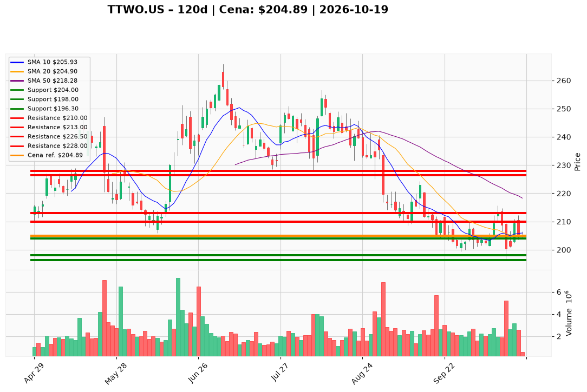

# TTWO.US — Ticket posiadacza (2026-10-19)

**Werdykt:** HOLD
**Horyzont:** swing (dni–tygodnie)
**Cena ref.:** $204.89

**Pozycja zapisana (TTWO.US):** wejście **$253.29**; SL **$204.00**; TP1 **$226.50**; TP2 **$228.00**.  
P/L vs $204.89: **−$48.40 (−19,1%)**.

| | Poziom | Uwagi |
|---|--------|------|
| **Akcja teraz** | trzymaj | bez dokupu; cena testuje SL — utrzymaj tylko przy close ≥ $204; brak reclaim >$207 na wolumenie = słaba jakość odbicia |
| **Stop-loss** | $204.00 | twardy; wyjście przy **close dzienny < $204.00** (dziś dołek $204.00) |
| **TP1** | $226.50 | redukcja części (strefa 50 SMA / plan) |
| **TP2** | $228.00 | redukcja reszty / częściowy exit nad kosztem niepełny — cele swing z pamięci |

**Sizing / skala:** 0% nowego kapitału. Trzymaj pełny lot. Ryzyko od wejścia do SL już zrealizowane w większości (−19%); od ceny ref. do SL ~0,4% — decyzja binarna.

**Warunek dokupu:** Brak. Add wyłącznie po zamknięciu > **$213.00** na wolumenie >2M (nie dotyczy tego ticketu — PM Hold).

**Unieważnienie / pełne wyjście:** Close < **$204.00** → pełny exit. Dodatkowo: close < **$196.30** (dołek 13.10) → exit bez czekania. Brak close > **$207** w ciągu 3 sesji przy dryfie w dół → rozważ redukcję mimo SL.

**Dlaczego (1–2 zdania):** PM **Hold**: jakość franczyzy i dodatni histogram MACD nie rekompensują **zepsutej struktury** (poniżej 10 EMA i 50/200 SMA, nieudane odbicie z $210). Przy **−19%** P/L sensowne jest **trzymanie wyłącznie przy żywym $204**, bez dokupu w test supportu.

**WERDYKT KOŃCOWY:** HOLD — trzymaj lot TTWO.US (wejście $253.29, P/L −19,1%) ze SL $204.00, TP1 $226.50 / TP2 $228.00; bez dokupu; wyjście przy close < $204.

