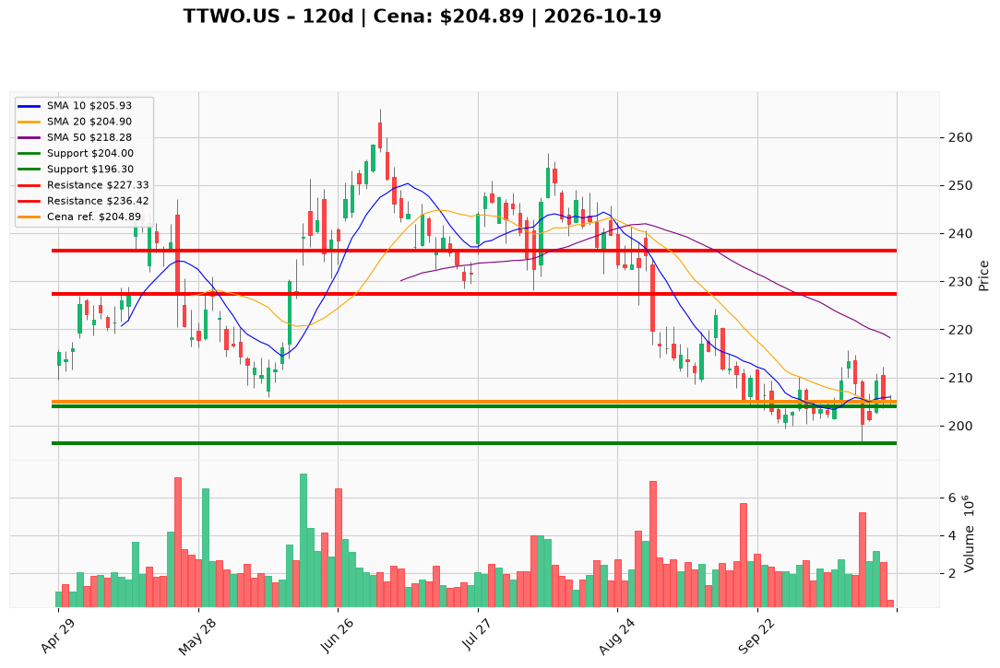

# TTWO.US — Ticket posiadacza (2026-10-19)

**Werdykt:** HOLD
**Horyzont:** swing (dni–tygodnie)
**Cena ref.:** $204.89

**Pozycja zapisana (TTWO.US#2):** wejście **$231.49**; SL **$204.00**; TP1 **$227.33**; TP2 **$236.42**.  
P/L vs $204.89: **−$26.60 (−11,5%)**.

| | Poziom | Uwagi |
|---|--------|------|
| **Akcja teraz** | trzymaj | bez dokupu; 19.10 dołek intraday **$204.00** = strefa SL — wyjście tylko przy **close < $204** |
| **Stop-loss** | $204.00 | twardy (close dzienny); nie poszerzaj |
| **TP1** | $227.33 | redukcja części (strefa 50 SMA ~$218+) |
| **TP2** | $236.42 | wyjście reszty / odzyskanie powyżej kosztu |

**Sizing / skala:** 0% nowego kapitału. Trzymaj pełny lot #2. Ryzyko od wejścia do SL ~11,9%; od ceny ref. do SL ~0,4% — ryzyko **gapa** pod stop.

**Warunek dokupu:** Brak. Add tylko po zamknięciu > **$213.00** na wolumenie >2M.

**Unieważnienie / pełne wyjście:** Close < **$204.00** → pełne wyjście. Close < **$196.30** (dołek 13.10) → exit bez czekania. Brak reclaim **$209–$213** w ciągu ~5 sesji przy słabnięciu MACD hist → rozważ redukcję.

**Dlaczego (1–2 zdania):** PM **Hold**: histogram MACD dodatni (+0.99) i cena na środku Bollingera wspierają stabilizację, ale trend nadal pod 50/200 SMA (~$218–$222) i test **$204** podnosi ryzyko wybicia stopa — przy −11,5% P/L nie dokupuj; cele $227/$236 zostają przy utrzymaniu flooru.

**WERDYKT KOŃCOWY:** HOLD — trzymaj lot TTWO.US#2 (wejście $231.49, P/L −11,5%) ze SL $204.00, TP1 $227.33 / TP2 $236.42; bez dokupu, wyjście przy close < $204.

