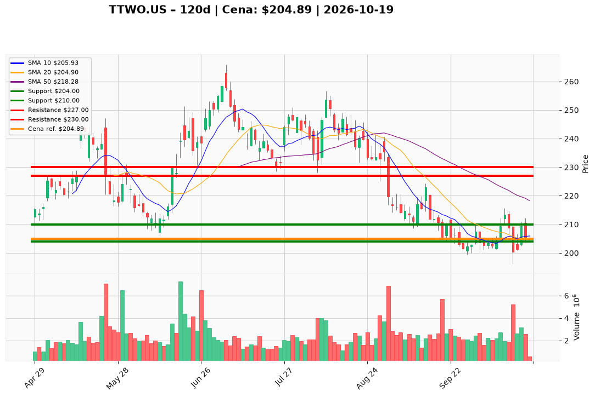

# TTWO.US — Ticket posiadacza (2026-10-19)

**Werdykt:** HOLD
**Horyzont:** swing (dni–tygodnie)
**Cena ref.:** $204.89

**Pozycja zapisana (TTWO.US#3):** wejście **$221.00**; poprzedni SL **$210.00**; TP1 **$227.00**; TP2 **$230.00**.  
P/L vs $204.89: **−$16.11 (−7,3%)**. Zamknięcia poniżej **$210** od flushu 13.10 — PM **zaostrza** SL do **$204** (zgodnie ze strukturą).

| | Poziom | Uwagi |
|---|--------|------|
| **Akcja teraz** | trzymaj | bez dokupu; cena na środku Boll (~$205), dołek sesji $204 — nie dokładaj w głąb straty |
| **Stop-loss** | $204.00 | twardy (close dzienny < $204 → pełne wyjście); zastępuje naruszony poziom $210 |
| **TP1** | $227.00 | redukcja części (strefa 50 SMA ~$218+) |
| **TP2** | $230.00 | wyjście reszty / plan swing |

**Sizing / skala:** 0% nowego kapitału. Trzymaj pełny lot #3. Ryzyko do SL ~0,4% od ceny ref. ($204.89 → $204) — bardzo ciasny; alternatywa konserwatywna: redukcja 50% jeśli nie akceptujesz ponownego testu $204.

**Warunek dokupu:** Brak. Add tylko po zamknięciu > **$213.00** na wolumenie >2M.

**Unieważnienie / pełne wyjście:** Close < **$204.00** → exit całości. Close < **$196.30** (dołek 13.10) na wolumenie → natychmiastowy exit. Brak reclaim **$210** w ciągu 5 sesji przy słabnięciu w kierunku $204 → rozważ **REDUCE** 50%.

**Dlaczego (1–2 zdania):** PM **Hold**: podłoga **$196–$204** utrzymana, histogram MACD dodatni (+0.99), ale trend pod 50/200 SMA i naruszony stary SL $210 — sens trzymać tylko z twardym **$204**, cele **$227/$230** bez dokupu.

**WERDYKT KOŃCOWY:** HOLD — trzymaj lot TTWO.US#3 (wejście $221.00, P/L −7,3%) ze SL **$204.00**, TP1 **$227.00** / TP2 **$230.00**; bez dokupu, wyjście przy close < $204.

