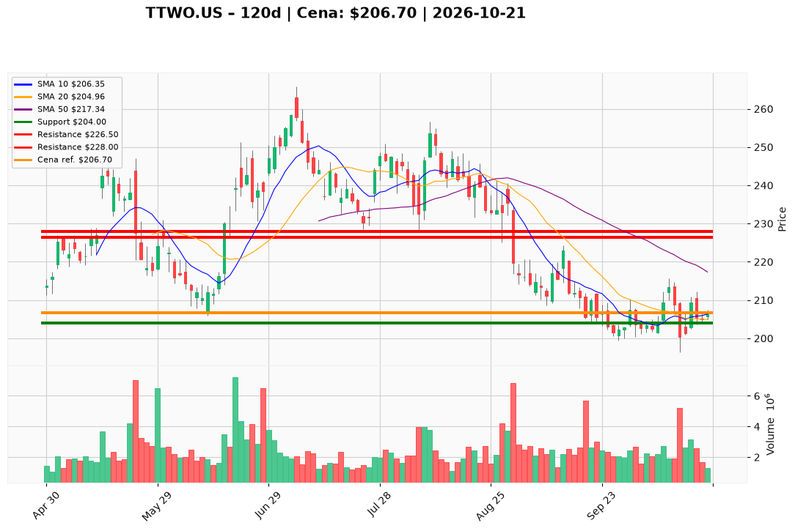

# TTWO.US — Ticket posiadacza (2026-10-21)

**Werdykt:** HOLD
**Horyzont:** swing (dni–tygodnie)
**Cena ref.:** $206.70

**Pozycja zapisana (TTWO.US):** wejście **$253.29**; SL **$204.00**; TP1 **$226.50**; TP2 **$228.00**.  
P/L vs $206.70: **−$46.59 (−18,4%)**.

| | Poziom | Uwagi |
|---|--------|------|
| **Akcja teraz** | trzymaj | bez dokupu; odbicie z $204 — utrzymaj przy close ≥ $204; brak reclaim >$210 na wolumenie >2M = słaba jakość trendu |
| **Stop-loss** | $204.00 | twardy; wyjście przy **close dzienny < $204.00** |
| **TP1** | $226.50 | redukcja części (strefa 50 SMA / plan) |
| **TP2** | $228.00 | redukcja reszty / częściowy exit |

**Sizing / skala:** 0% nowego kapitału. Trzymaj pełny lot. Od ceny ref. do SL ~1,3% — decyzja nadal binarna przy supportcie.

**Warunek dokupu:** Brak. Add wyłącznie po zamknięciu > **$213.00** na wolumenie >2M (PM Hold).

**Unieważnienie / pełne wyjście:** Close < **$204.00** → pełny exit. Dodatkowo: close < **$196.30** (dołek 13.10) → exit bez czekania. Brak close > **$210** w ciągu 5 sesji przy dryfie w dół → rozważ redukcję mimo SL.

**Dlaczego (1–2 zdania):** PM **Hold**: histogram MACD dodatni i utrzymanie $204 nie naprawiają struktury (poniżej 10 EMA i SMA). Przy **−18,4%** P/L sensowne jest **trzymanie przy żywym $204**, bez dokupu.

**WERDYKT KOŃCOWY:** HOLD — trzymaj lot TTWO.US (wejście $253.29, P/L −18,4%) ze SL $204.00, TP1 $226.50 / TP2 $228.00; bez dokupu; wyjście przy close < $204.

