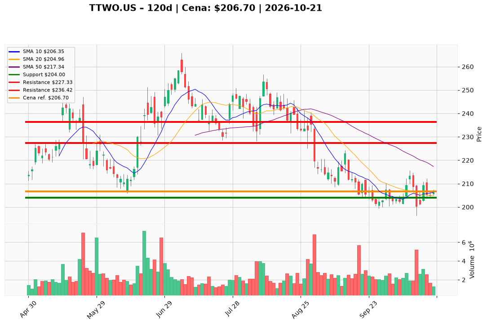

# TTWO.US — Ticket posiadacza (2026-10-21)

**Werdykt:** HOLD
**Horyzont:** swing (dni–tygodnie)
**Cena ref.:** $206.70

**Pozycja zapisana (TTWO.US#2):** wejście **$231.49**; SL **$204.00**; TP1 **$227.33**; TP2 **$236.42**.  
P/L vs $206.70: **−$24.79 (−10,7%)**. Cena powyżej twardego SL **$204** — utrzymuj plan bez dokupu.

| | Poziom | Uwagi |
|---|--------|------|
| **Akcja teraz** | trzymaj | bez dokupu; zamknięcie nad Boll mid i 10 EMA, ale pod 50/200 SMA |
| **Stop-loss** | $204.00 | twardy (close dzienny < $204 → pełne wyjście) |
| **TP1** | $227.33 | redukcja części (strefa 50 SMA ~$217+) |
| **TP2** | $236.42 | wyjście reszty / plan swing |

**Sizing / skala:** 0% nowego kapitału. Trzymaj pełny lot #2. Ryzyko do SL ~1,3% od ceny ref.

**Warunek dokupu:** Brak. Add tylko po zamknięciu > **$213.00** na wolumenie >2M.

**Unieważnienie / pełne wyjście:** Close < **$204.00** → exit całości. Close < **$196.30** (dołek 13.10) na wolumenie → natychmiastowy exit. Brak przełamania **$211** w ciągu 5 sesji przy słabnięciu → rozważ **REDUCE** 30–50%.

**Dlaczego (1–2 zdania):** PM **Hold**: podłoga **$196–$204** utrzymana, histogram MACD dodatni (+1.03) i lekki odbicie do **$206.70**, lecz trend pod kluczowymi SMA i lot **−10,7%** — sens trzymać tylko z SL **$204**, cele **$227.33 / $236.42** bez dokupu.

**WERDYKT KOŃCOWY:** HOLD — trzymaj lot TTWO.US#2 (wejście $231.49, P/L −10,7%) ze SL **$204.00**, TP1 **$227.33** / TP2 **$236.42**; bez dokupu, wyjście przy close < $204.

