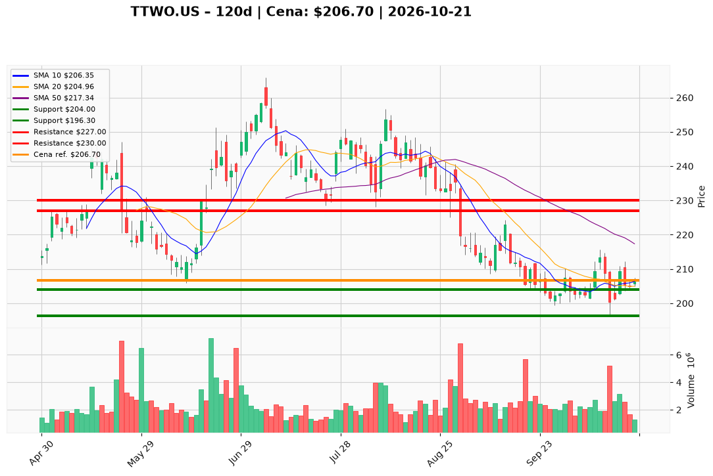

# TTWO.US — Ticket posiadacza (2026-10-21)

**Werdykt:** HOLD
**Horyzont:** swing (dni–tygodnie)
**Cena ref.:** $206.70

**Pozycja zapisana (TTWO.US#3):** wejście **$221.00**; SL **$204.00**; TP1 **$227.00**; TP2 **$230.00**.  
P/L vs $206.70: **−$14.30 (−6,5%)**. Cena powyżej środka Boll (~$205) i 10 EMA — lekka poprawa vs poprzednią sesją, nadal pod 50/200 SMA (~$217/$222).

| | Poziom | Uwagi |
|---|--------|------|
| **Akcja teraz** | trzymaj | bez dokupu przy $206.70; nie dokładaj w stratę |
| **Stop-loss** | $204.00 | twardy (close dzienny < $204 → pełne wyjście) |
| **TP1** | $227.00 | redukcja części (strefa 50 SMA) |
| **TP2** | $230.00 | wyjście reszty / plan swing |

**Sizing / skala:** 0% nowego kapitału. Trzymaj pełny lot #3.

**Warunek dokupu:** Brak przy obecnej cenie. Add tylko po zamknięciu > **$213.00** na wolumenie >2M (opcjonalnie).

**Unieważnienie / pełne wyjście:** Close < **$204.00** → exit całości. Close < **$196.30** (dołek 13.10) na wolumenie → natychmiastowy exit. Brak reclaim **$218** w ciągu ~2 tygodni przy słabnięciu → rozważ **REDUCE** 25–50%.

**Dlaczego (1–2 zdania):** PM **Hold**: podłoga **$196–$204** utrzymana, histogram MACD dodatni (+1.03), FCF wspiera cierpliwość — ale trend pod kluczowymi MA; dla lotu @ $221 sens trzymać tylko z twardym **$204**, cele **$227/$230** bez dokupu.

**WERDYKT KOŃCOWY:** HOLD — trzymaj lot TTWO.US#3 (wejście $221.00, P/L −6,5%) ze SL **$204.00**, TP1 **$227.00** / TP2 **$230.00**; bez dokupu, wyjście przy close < $204.

