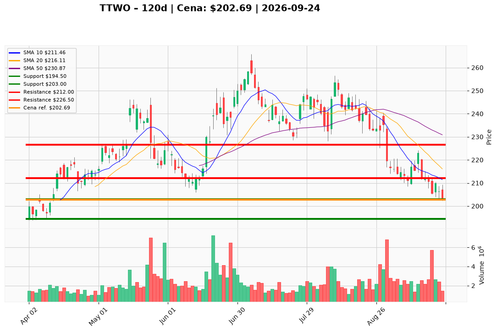

# TTWO — Ticket (2026-09-24)

**Werdykt:** BUY
**Horyzont:** swing (dni–tygodnie)
**Cena ref.:** $202.69

| | Poziom | Uwagi |
|---|--------|------|
| **Wejście** | $202.50–$205.50 | **aktywne teraz** — cena w strefie wsparcia $203–$208 (day low $202.37); limit GTC $205.50 wypełni się po ~$202–$203; nie gonić powyżej $212 bez zamknięcia powyżej VWMA |
| **Stop-loss** | $194.50 | hard invalidation — poniżej dołka z 16 VI i bear-case PM |
| **TP1** | $212.00 | zrealizuj ~50% przy VWMA / pierwszej oporze wolumenowym |
| **TP2** | $226.50 | reszta przy klastrze SMA 200 (~226–228) lub trailing po potwierdzeniu trendu |

**Sizing:** ryzyko ≤0.5% kapitału na pełną odległość do SL (~$8–9 od $202.69); start ~0,15–0,20% ekspozycji do zamknięcia powyżej $212
**Warunek aktywacji:** — (spełniony: cena w paśmie $203–$208; wcześniejszy WAIT oparty na błędnej cenie ref. $209.92)
**Unieważnienie:** dzienne zamknięcie poniżej $194.50 lub wiarygodna plotka o opóźnieniu GTA VI przed weryfikacją

**Dlaczego (1–2 zdania):** PM Overweight na asymetryczny upside GTA VI przy ~19,7× forward P/E — pierwotny WAIT wynikał z ceny ~$209,92 powyżej strefy akumulacji; przy ~$202,69 (Yahoo close $203.08, day low $202.37) jesteś w docelowym paśmie $203–$208, więc limit $205.50 / wejście po rynku jest zgodne z planem Trader/PM.

**WERDYKT KOŃCOWY:** BUY — wejdź małą pozycją w strefie $202.50–$205.50 ze SL $194.50; nie czekaj na odbicie do $209.

