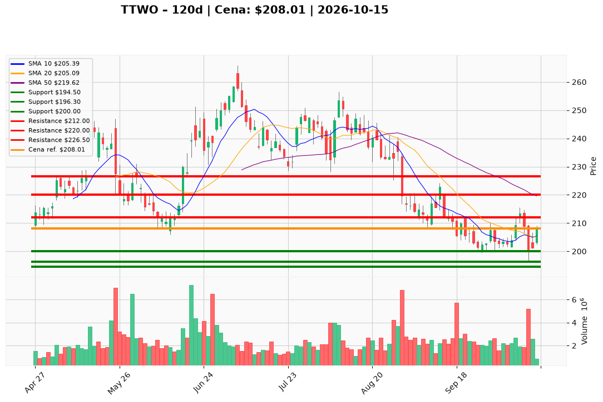

# TTWO — Ticket posiadacza (2026-10-15)

**Werdykt:** HOLD
**Horyzont:** swing (dni–tygodnie)
**Cena ref.:** $208.01

**Pozycja zapisana (TTWO):** wejście **$202.69**; SL **$194.50**; TP1 **$212.00**; TP2 **$226.50**.  
P/L vs $208.01: **+$5.32 (+2,6%)**.

| | Poziom | Uwagi |
|---|--------|------|
| **Akcja teraz** | trzymaj | bez dokupu; zarządzaj SL/TP według tabeli |
| **Stop-loss** | $194.50 | twardy; wyjście przy close < $194.50 |
| **TP1** | $212.00 | redukcja części (górny Bollinger ~$212.02) |
| **TP2** | $226.50 | wyjście reszty (strefa 200 SMA) |

**Sizing / skala:** 0% nowego kapitału. Trzymaj pełny lot. Ryzyko od $208.01 do $194.50 ≈ 6,5%. Opcjonalnie odbierz 30–50% przy TP1, reszta do TP2.

**Warunek dokupu:** Brak domyślnie. Add tylko po dziennym zamknięciu **>$212.00** na wolumenie **>2,5M**.

**Unieważnienie / pełne wyjście:** Close **< $194.50** → wyjście 100% na market. Nie poszerzaj stopa po kolejnym macro risk-off.

**Dlaczego (1–2 zdania):** PM Hold: odbicie po flushu 13.10 (dołek $196.30, wolumen 5,2M), histogram MACD dodatni i cena nad 10 EMA, ale nadal pod 50/200 SMA i w tle słabszy tech — swing do $212/$226 z twardym SL $194.50, bez dokupu w paśmie.

**WERDYKT KOŃCOWY:** HOLD — trzymaj lot TTWO (wejście $202.69, P/L +2,6%) ze SL $194.50, TP1 $212.00 / TP2 $226.50; bez dokupu, wyjście przy close < $194.50.

