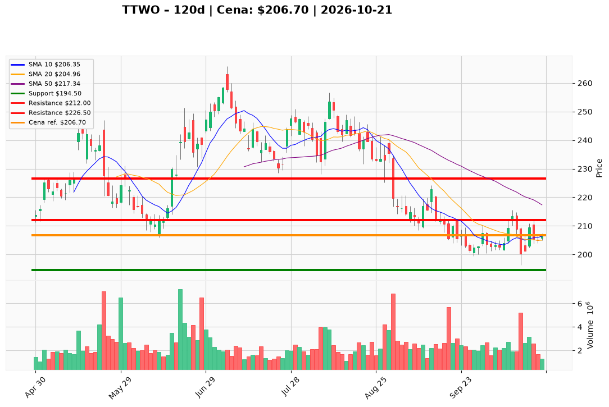

# TTWO — Ticket posiadacza (2026-10-21)

**Werdykt:** HOLD
**Horyzont:** swing (dni–tygodnie)
**Cena ref.:** $206.70

**Pozycja zapisana (lot TTWO):** wejście **$202.69**; SL **$194.50**; TP1 **$212.00**; TP2 **$226.50**.  
P/L vs $206.70: **+$4.01 (+2,0%)**.

| | Poziom | Uwagi |
|---|--------|------|
| **Akcja teraz** | trzymaj | bez dokupu; baza $200–207 po szoku 13.10, cena pod 50/200 SMA |
| **Stop-loss** | $194.50 | twardy; wyjście przy close < $194.50 |
| **TP1** | $212.00 | redukcja części (górna BB / trigger swing) |
| **TP2** | $226.50 | wyjście reszty (strefa 50 SMA ~$217+) |

**Sizing / skala:** 0% nowego kapitału. Trzymaj pełny lot. Ryzyko od $206.70 do SL $194.50 ≈ 5,9%. Nie dokupuj — insiderzy sprzedawali ~$200–204, trend MT nadal słaby mimo poprawy histogramu MACD (+1,03).

**Warunek dokupu:** Brak. Add dopiero po zamknięciu dziennego **> $212.00** na wolumenie **> 2,5M**.

**Unieważnienie / pełne wyjście:** Close < **$194.50** → wyjście 100%. Sygnał ostrzegawczy: utrzymane close < **$200.00** bez szybkiego odbicia — rozważ wcześniejszą redukcję.

**Dlaczego (1–2 zdania):** PM Hold: lot na plusie po stabilizacji, FCF i forward P/E wspierają trzymanie, ale brak przełamania $212 i sprzedaże insiderów przy obecnych poziomach — warunkowy hold ze SL $194.50 i celami $212 / $226.50.

**WERDYKT KOŃCOWY:** HOLD — trzymaj lot TTWO (wejście $202.69, P/L +2,0%) ze SL $194.50, TP1 $212.00 / TP2 $226.50; bez dokupu do potwierdzenia > $212 na wolumenie; wyjście przy close < $194.50.

