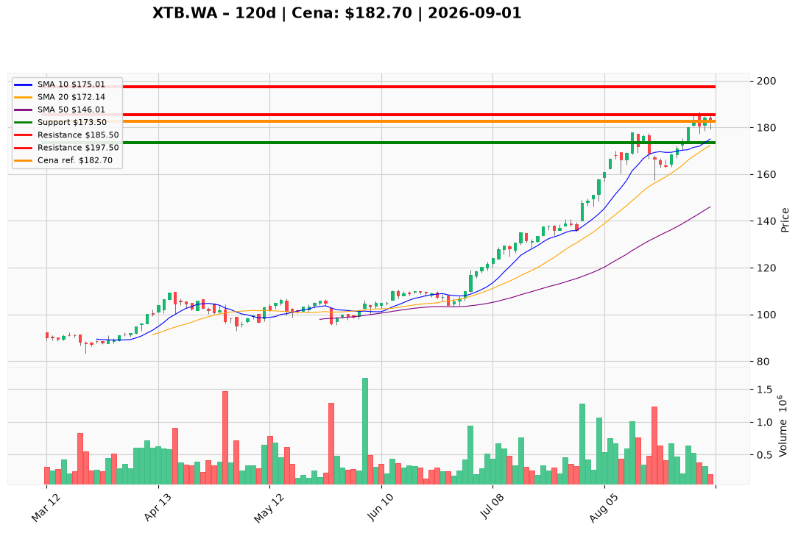

# XTB.WA — Ticket posiadacza (2026-09-01)

**Werdykt:** HOLD
**Horyzont:** position (miesiące–kwartały)
**Cena ref.:** 182,70 PLN

| | Poziom | Uwagi |
|---|--------|------|
| **Akcja teraz** | trzymaj rdzeń | bez dokupu @ market; redukcja 30–40% w strefie 184–187, jeśli pozycja skoncentrowana |
| **Stop-loss** | 173,50 PLN | twardy / trailing na reszcie po TP1 |
| **TP1** | 185,50 PLN | pierwsza redukcja części w oporze ATH 184–187 |
| **TP2** | 197,50 PLN | wyjście z reszty po potwierdzonym zamknięciu dziennym powyżej 187 z wolumenem >700K i dodatnim MACD |

**Sizing / skala:** Utrzymaj rdzeń — XTB to wysokiej jakości broker z marżą >40%, gotówką PLN 2,66 mld i trendem wzrostowym. Przy skoncentrowanej ekspozycji sprzedaj 30–40% w TP1; resztę trzymaj z SL 173,50 tak, aby ryzyko ≤1,0–1,5% kapitału portfela. Brak nowego kapitału do czasu pullbacku 171–177 lub breakoutu powyżej 187.

**Warunek dokupu (ADD):** limit ~174 PLN w strefie 171–177 (VWMA / 10 EMA) przy RSI 60–65 i wygasającym wolumenie, albo dokup po potwierdzeniu breakoutu powyżej 187 z wolumenem >700K — do tego czasu brak dokupu.

**Unieważnienie / pełne wyjście:** zamknięcie dzienne poniżej 157,40 PLN (dołek swing z 18.08) — wyjście z całości; SL 173,50 na reszcie pozycji.

**Dlaczego (1–2 zdania):** Fundamenty pozostają wyjątkowe, ale przy 182,70 PLN asymetria wejścia jest słaba: RSI 71,3 (7 sesji w wykupieniu), ujemny histogram MACD i opór ATH 184–187 sygnalizują zmęczenie momentum, nie świeży impuls. PM i Trader zgodnie: trzymaj istniejącą pozycję z aktywnym zarządzaniem ryzykiem, redukuj w oporze, nie dokupuj @ market.

**WERDYKT KOŃCOWY:** HOLD — trzymaj rdzeń, redukcja 30–40% @ 184–187 jeśli skoncentrowana, SL 173,50, TP1 185,50 / TP2 197,50; brak dokupu do pullbacku 171–177 lub breakoutu >187.

