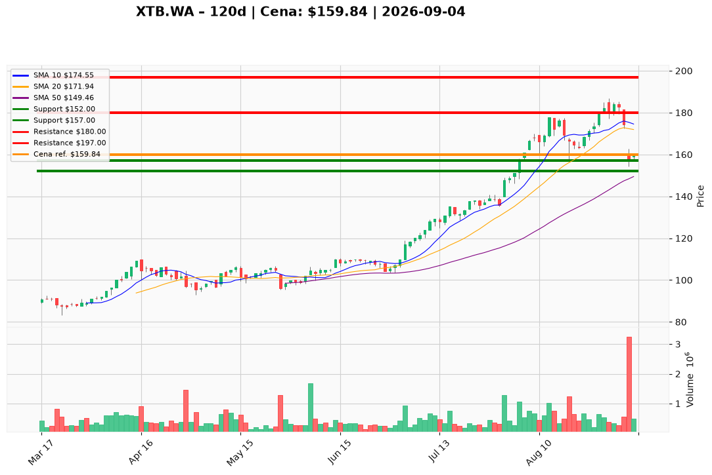

# XTB.WA — Ticket posiadacza (2026-09-04)

**Werdykt:** HOLD
**Horyzont:** pozycja (tygodnie–miesiące)
**Cena ref.:** 159,84 PLN

| | Poziom | Uwagi |
|---|--------|------|
| **Akcja teraz** | Trzymaj | Brak dokupu przy cenie rynkowej |
| **Stop-loss** | 152,00 PLN | twardy — poniżej dołka po sprzedaży bloku |
| **TP1** | 180,00 PLN | redukcja części (~30–40%) |
| **TP2** | 197,00 PLN | wyjście reszty / cel wydłużony |

**Pozycja zapisana:** wejście **164,00 PLN** | P/L: **-2,5%** vs cena ref.

**Sizing / skala:** Utrzymaj obecną ekspozycję. Nie dokupuj bez zamknięcia dziennego powyżej 166 PLN z wolumenem >500 tys. Opcjonalnie redukcja 25% przy odbiciu do 170–172 PLN (strefa oporu).

**Warunek dokupu** (jeśli ADD): Zamknięcie dzienne >166 PLN + rosnący wolumen; wtedy dokup max 50% obecnej pozycji.

**Unieważnienie / pełne wyjście:** Zamknięcie dzienne poniżej 152 PLN — wyjście w całości, baza po ABB złamana.

**Dlaczego (1–2 zdania):** XTB po sprzedaży bloku XX ZW (160 PLN) ustabilizował się powyżej ceny transakcji, a fundamenty (P/E ~15, marża netto 41%, ROE 59%) pozostają silne. Krótkoterminowy momentum jest słaby (MACD ujemny, cena poniżej EMA10), więc dla pozycji z wejściem 164 PLN optymalne jest trzymanie z twardym SL 152 PLN i celami 180/197 PLN.

**WERDYKT KOŃCOWY:** HOLD — trzymaj pozycję, nie dokupuj na rynku, honoruj stop 152 PLN, realizuj częściowo przy 180 PLN.

