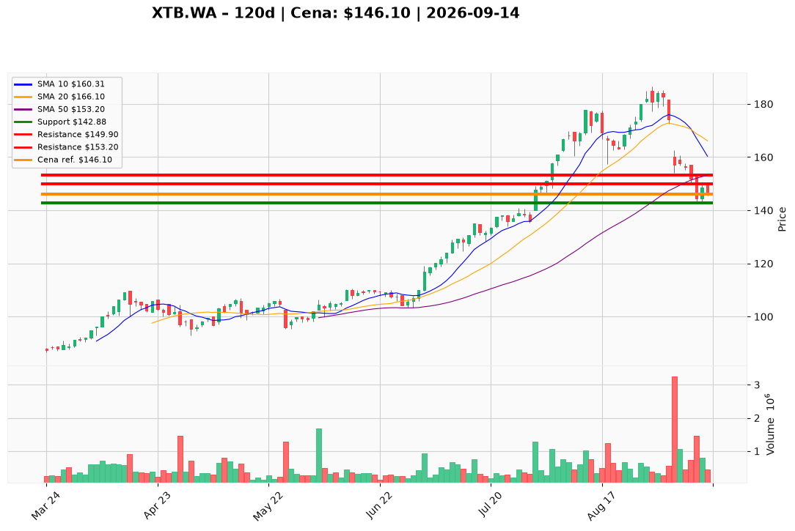

# XTB.WA — Ticket posiadacza (2026-09-14)

**Werdykt:** REDUCE
**Horyzont:** pozycja (tygodnie–miesiące)
**Cena ref.:** 146,10 PLN

**Pozycja zapisana (XTB.WA):** wejście **164,00 PLN**; SL zapisany **152,00 PLN**; TP1 zapisany **180,00 PLN**; TP2 zapisany **197,00 PLN**.
P/L vs 146,10: **−17,90 PLN (−10,9%)**. Zapisany SL 152,00 jest już przebity (dołek 10 IX 142,88; close 14 IX 146,10) — pierwszy trim na rynku, nie czekać na 149,90.

| | Poziom | Uwagi |
|---|--------|------|
| **Akcja teraz** | Sprzedaj ~50% @ market | PM Underweight; cut @ 146,10; zero dokupu w 143–153 |
| **Stop-loss** | **142,88 PLN** | twardy — zamknięcie dzienne (PM nadpisuje zapisany 152,00). Resztę licz jak ryzyko do **135,80** (1,5× ATR) |
| **TP1** | **149,90 PLN** | kolejna redukcja w oblanym capie 11/14 IX (zapisany 180,00 nieaktualny) |
| **TP2** | **153,20 PLN** | wyjście reszty taktycznej przy rosnącej SMA 50; max. mały stub. Zapisane 180/197 tylko po reclaim 156,49 |

**Sizing / skala:** Co najmniej połowa lota teraz @ 146,10. Reszta: limity 149,90 / 153,20. Ewentualny stub 0,5–1,0% kapitału liczony do 135,80 (~10,3 PLN). Zero nowego kapitału w 143–153. Nie shortuj rosnącej SMA 200.

**Warunek dokupu:** Brak. ADD zablokowany do zamknięcia dziennego **>156,49** z histogramem MACD w górę.

**Unieważnienie / pełne wyjście:** Zamknięcie dzienne **<142,88 PLN** przy wolumenie >800k → spłaszcz resztę taktyczną od razu (nie czekać 140,67). Zamknięcie **>156,49** z naprawą MACD → wstrzymaj dalszy trim, oceń stub.

**Dlaczego (1–2 zdania):** PM Underweight, Trader Sell: 146,10 to nieudany bounce po utracie EMA 10 (156,49) i SMA 50 (153,20), MACD −1,87 — ABB 160 jest ~9% wyżej, nie dokupywać. Franchise (KDPW ~620k, TTM NI 1,26 mld PLN, marża 41%) każe REDUCE ze stubem, nie EXIT nazwy; lot z 164,00 ma SL 152 już za sobą.

**WERDYKT KOŃCOWY:** **REDUCE** — sprzedaj ~50% XTB.WA @ market (wejście 164,00; P/L −10,9%); resztę skaluj 149,90 / 153,20; SL **142,88** / TP1 **149,90** / TP2 **153,20** PLN (zapisane 152 / 180 / 197: SL przebity, 180/197 dopiero po 156,49).

