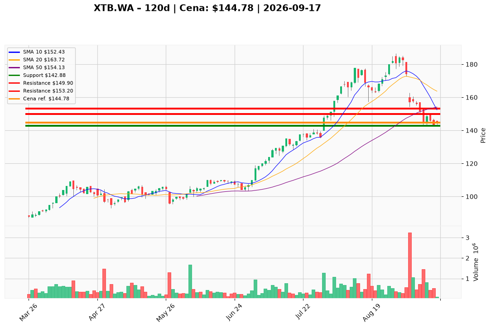

# XTB.WA — Ticket posiadacza (2026-09-17)

**Werdykt:** REDUCE
**Horyzont:** pozycja (tygodnie–miesiące)
**Cena ref.:** 144,78 PLN

**Pozycja zapisana (XTB.WA):** wejście **164,00 PLN**; SL zapisany **142,88 PLN**; TP1 zapisany **149,90 PLN**; TP2 zapisany **153,20 PLN**.
P/L vs 144,78: **−19,22 PLN (−11,7%)**. Cena 1,3% nad dołkiem 10 IX (142,88); MACD −3,57 i brak reclaim 150 — utrzymuj REDUCE, nie dokupuj.

| | Poziom | Uwagi |
|---|--------|------|
| **Akcja teraz** | Sprzedaj ~50% @ market | PM Underweight; cut @ 144,78; zero dokupu w 143–153 |
| **Stop-loss** | **142,88 PLN** | twardy — zamknięcie dzienne. Resztę licz do **133,35** (1,5× ATR) |
| **TP1** | **149,90 PLN** | redukcja reszty przy odbiciu do strefy 11/14 IX |
| **TP2** | **153,20 PLN** | wyjście stubu przy SMA 50 (~154,13); 180/197 dopiero po reclaim **156,49** |

**Sizing / skala:** Co najmniej połowa lota teraz @ 144,78. Reszta: limity 149,90 / 153,20. Stub 0,5–1,0% kapitału ze SL 142,88. Zero nowego kapitału w 143–153.

**Warunek dokupu:** Brak. ADD zablokowany do zamknięcia dziennego **>156,49** z histogramem MACD w górę.

**Unieważnienie / pełne wyjście:** Zamknięcie dzienne **<142,88 PLN** przy wolumenie >800k → spłaszcz resztę od razu (nie czekaj 133). Zamknięcie **>156,49** z naprawą MACD → wstrzymaj dalszy trim.

**Dlaczego (1–2 zdania):** PM Underweight: 144,78 to konsolidacja tuż nad 142,88 po nieudanym bounce 149,90 i sprzedaży ABB @ 160 PLN; MACD −3,57. Franchise (KDPW ~620k kont, TTM NI 1,26 mld PLN, marża 41%) każe REDUCE ze stubem, nie EXIT; lot z 164,00 wymaga aktywnego cięcia ryzyka.

**WERDYKT KOŃCOWY:** **REDUCE** — sprzedaj ~50% XTB.WA @ market (wejście 164,00; P/L −11,7%); resztę skaluj 149,90 / 153,20; SL **142,88** / TP1 **149,90** / TP2 **153,20** PLN.

