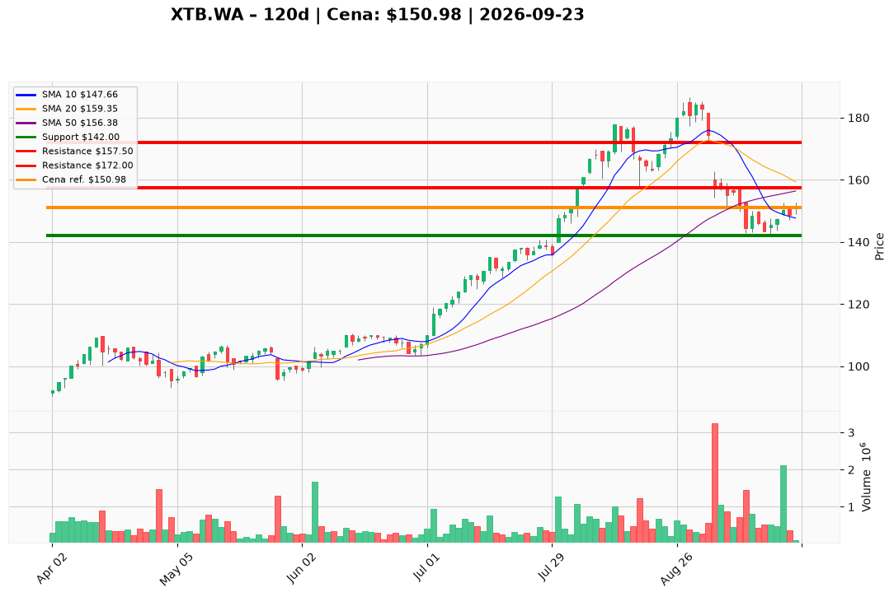

# XTB.WA — Ticket posiadacza (2026-09-23)

**Werdykt:** HOLD
**Horyzont:** pozycja (tygodnie–miesiące)
**Cena ref.:** 150,98 PLN

**Pozycja zapisana (lot XTB.WA#2):** wejście 146,88 PLN | P/L: +4,10 PLN (+2,8%)

| | Poziom | Uwagi |
|---|--------|------|
| **Akcja teraz** | Trzymaj | Bez dokupu do potwierdzenia powyżej 157 PLN |
| **Stop-loss** | 142,00 PLN | twardy — pod dołkiem z 16.09 |
| **TP1** | 157,50 PLN | redukcja ~30% (SMA 50) |
| **TP2** | 172,00 PLN | wyjście reszty (strefa sierpnia) |

**Sizing / skala:** Utrzymaj pełny lot; nie dokupuj przed zamknięciem powyżej 157 PLN z wolumenem. Ryzyko od ceny ref.: ~6% do SL.

**Warunek dokupu** (jeśli ADD): Zamknięcie dzienne >157 PLN + wolumen >500 tys. szt.

**Unieważnienie / pełne wyjście:** Zamknięcie dzienne poniżej 142 PLN — wyjście z całej pozycji.

**Dlaczego (1–2 zdania):** Fundamenty XTB pozostają silne (P/E 14×, marża 41%, ROE 59%, +620 tys. rachunków), a korekta -24% od ATH wygląda na techniczną — dołek 142 PLN wytrzymał, 18.09 przyniósł silny odbiór. Cena wciąż poniżej SMA 50, więc cierpliwość zamiast agresywnego dokupu.

**WERDYKT KOŃCOWY:** HOLD — trzymaj lot po 146,88 PLN ze stop-loss 142 PLN i celami 157,50 / 172 PLN; nie dokupuj do przełamania SMA 50.

