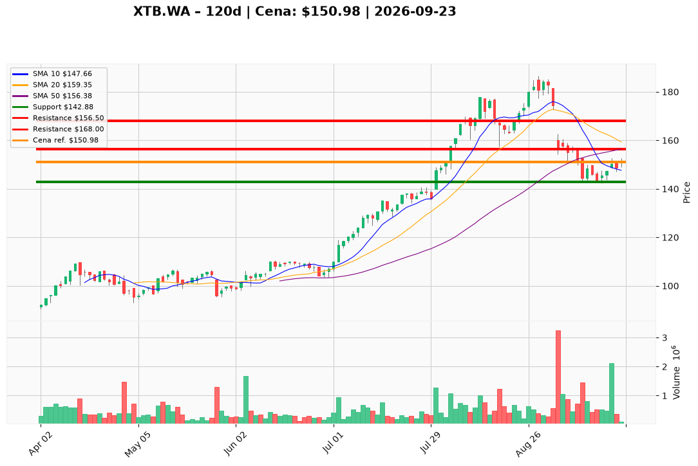

# XTB.WA — Ticket posiadacza (2026-09-23)

**Werdykt:** HOLD
**Horyzont:** pozycja (tygodnie–miesiące)
**Cena ref.:** 150,98 PLN

**Pozycja zapisana (XTB.WA):** wejście **164,00 PLN**; SL zapisany **142,88 PLN**; TP1 zapisany **149,90 PLN**; TP2 zapisany **153,20 PLN**.
P/L vs 150,98: **−13,02 PLN (−7,9%)**. Odbicie +5,7% od dołka 10 IX (142,88); MACD histogram poprawia się (−1,40 vs −4,77); cena powyżej 10 EMA (150,56) — utrzymuj HOLD, nie dokupuj poniżej SMA 50.

| | Poziom | Uwagi |
|---|--------|------|
| **Akcja teraz** | Trzymaj całość | PM Hold; zero dokupu poniżej 156,50 |
| **Stop-loss** | **142,88 PLN** | twardy — zamknięcie dzienne <142,88 przy wolumenie >800k → EXIT |
| **TP1** | **156,50 PLN** | redukcja ~25% przy reclaim SMA 50 |
| **TP2** | **168,00 PLN** | wyjście reszty przy strefie wsparcia VIII; droga do breakeven 164 |

**Sizing / skala:** Pełny lot bez zmian @ 150,98. Przy TP1 (156,50) sprzedaj ~25% na wolumenie >500k. Reszta ze SL 142,88 do TP2 168,00. Zero nowego kapitału poniżej 156,50.

**Warunek dokupu:** Brak. ADD zablokowany do zamknięcia dziennego **>160,00** (cena ABB) z histogramem MACD w górę i wolumenem >600k.

**Unieważnienie / pełne wyjście:** Zamknięcie dzienne **<142,88 PLN** przy wolumenie >800k → spłaszcz całość od razu. Zamknięcie **>160,00** z naprawą MACD → rozważ ADD (poza zakresem tego ticketu).

**Dlaczego (1–2 zdania):** PM Hold: 150,98 to stabilizacja po kapitulacji 142,88; fundamenty (P/E 14x, ROE 58%, 620k kont/rok) uzasadniają cierpliwość, ale ABB @ 160 PLN i MACD −3,67 wymagają dyscypliny — lot z 164,00 wymaga trzymania ze zdefiniowanym SL, nie panicznej sprzedaży na odbiciu.

**WERDYKT KOŃCOWY:** **HOLD** — trzymaj XTB.WA @ 150,98 (wejście 164,00; P/L −7,9%); skaluj 25% przy TP1 **156,50** / reszta do TP2 **168,00** PLN; SL **142,88** PLN.

