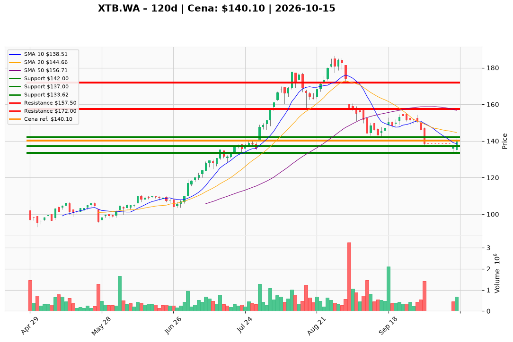

# XTB.WA — Ticket posiadacza (2026-10-15)

**Werdykt:** HOLD
**Horyzont:** pozycja (tygodnie–miesiące)
**Cena ref.:** 140,10 PLN

**Pozycja zapisana (XTB.WA#2):** wejście **146,88 PLN**; SL **142,00 PLN**; TP1 **157,50 PLN**; TP2 **172,00 PLN**.
P/L vs 140,10: **−6,78 PLN (−4,6%)**. Odbicie z dołka 14 X (133,62); cena pod 50 SMA (156,71) i tuż przy 10 EMA (140,14) — trzymaj bez dokupu do reclaimu ~147,50.

| | Poziom | Uwagi |
|---|--------|------|
| **Akcja teraz** | Trzymaj całość lotu #2 | PM Hold; zero dokupu poniżej 147,50 |
| **Stop-loss** | **142,00 PLN** | twardy poziom planu; operacyjny EXIT przy zamknięciu dzienneym **<137,00** (wolumen >600k) |
| **TP1** | **157,50 PLN** | redukcja ~25% przy dotknięciu strefy 50 SMA |
| **TP2** | **172,00 PLN** | wyjście reszty przy naprawie trendu |

**Sizing / skala:** Pełny lot #2 bez zmian @ 140,10. Przy TP1 sprzedaj ~25%. Reszta ze SL 142,00 do TP2 172,00. Brak nowego kapitału do zamknięcia >147,50.

**Warunek dokupu:** Brak (ADD zablokowany). Ewentualny dokup tylko po zamknięciu dziennym **>147,50** z wolumenem >500k — poza tym ticketem.

**Unieważnienie / pełne wyjście:** Zamknięcie dzienne **<137,00 PLN** przy wolumenie >600k → spłaszcz całość. Zamknięcie powyżej **157,50** z utrzymaniem → realizuj część według TP1.

**Dlaczego (1–2 zdania):** PM Hold: fundamenty (P/E ~13, ROE 58%, wzrost rachunków) uzasadniają cierpliwość na lotcie 146,88, ale korekta techniczna i nota PKO wymagają dyscypliny — nie dokupuj w trendzie spadkowym, trzymaj ze zdefiniowanym SL i planem skalowania na 157,50 / 172,00.

**WERDYKT KOŃCOWY:** **HOLD** — trzymaj XTB.WA#2 @ 140,10 (wejście 146,88; P/L −4,6%); skaluj ~25% przy TP1 **157,50** / reszta do TP2 **172,00** PLN; SL **142,00** PLN (pełny wyjście przy zamknięciu **<137,00**).

