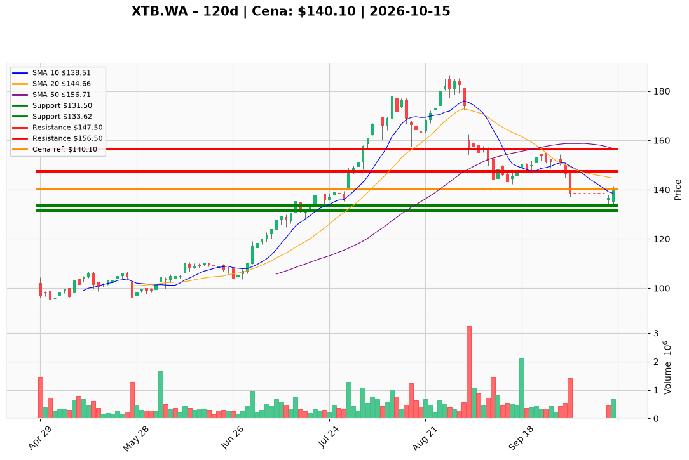

# XTB.WA — Ticket posiadacza (2026-10-15)

**Werdykt:** HOLD
**Horyzont:** pozycja (tygodnie–miesiące)
**Cena ref.:** 140,10 PLN

**Pozycja zapisana (XTB.WA#3):** wejście **141,00 PLN**; brak wcześniejszego SL/TP w pamięci — poniżej poziomy z PM po korekcie październikowej.
P/L vs 140,10: **−0,90 PLN (−0,6%)**. Odbicie z dołka 14 X (133,62); cena na 10 EMA (~140,14); histogram MACD lekko poprawia się (−0,15 vs −0,47); nadal **~11% pod SMA 50** (156,71) — trzymaj lot przy ~141, bez dokupu.

| | Poziom | Uwagi |
|---|--------|------|
| **Akcja teraz** | Trzymaj całość | PM Hold; zero dokupu poniżej 150,00 |
| **Stop-loss** | **131,50 PLN** | twardy — zamknięcie dzienne <131,50 przy wolumenie >700k → EXIT |
| **TP1** | **147,50 PLN** | redukcja ~25% przy teście strefy BB / 1 X |
| **TP2** | **156,50 PLN** | wyjście reszty przy SMA 50; droga do zysku z 141 |

**Sizing / skala:** Pełny lot #3 bez zmian @ 140,10. Przy TP1 (147,50) sprzedaj ~25% na wolumenie >500k. Reszta ze SL 131,50 do TP2 156,50. Zero nowego kapitału poniżej 150,00.

**Warunek dokupu:** Brak. ADD zablokowany do zamknięcia dziennego **>150,00** z histogramem MACD w górę i wolumenem >600k.

**Unieważnienie / pełne wyjście:** Zamknięcie dzienne **<131,50 PLN** przy wolumenie >700k → spłaszcz całość od razu. Zamknięcie **>156,50** z naprawą trendu → oceń ADD (poza tym ticketem).

**Dlaczego (1–2 zdania):** PM Hold: lot #3 przy 141 PLN jest praktycznie na zero po flushu do 133,62; fundamenty (P/E ~13×, ROE ~58%, ~620k kont/rok) i news produktowy uzasadniają cierpliwość, ale korekta GPW i MACD −4,5 wymagają SL pod październikowym dołkiem, nie dokupu w dziurze pod SMA 50.

**WERDYKT KOŃCOWY:** **HOLD** — trzymaj XTB.WA#3 @ 140,10 (wejście 141,00; P/L −0,6%); skaluj 25% przy TP1 **147,50** / reszta do TP2 **156,50** PLN; SL **131,50** PLN.

