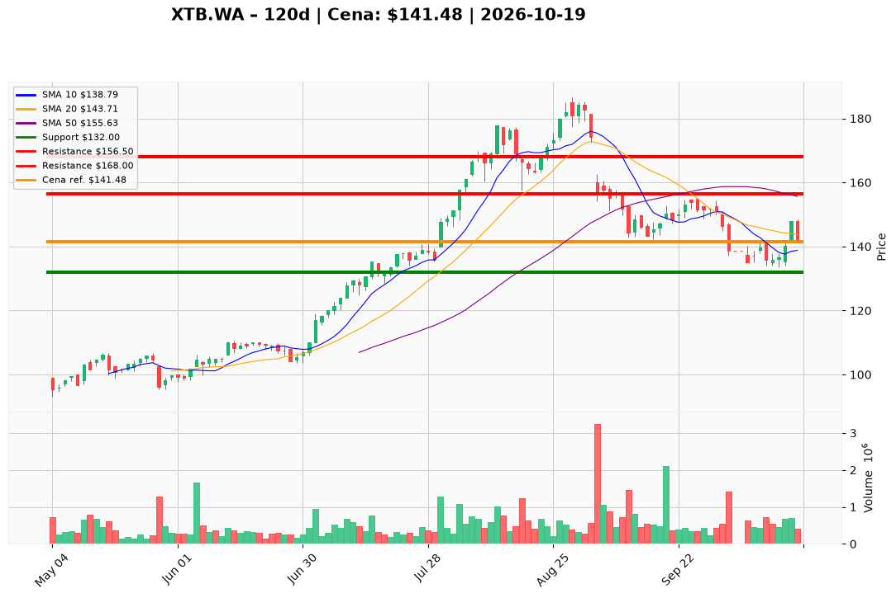

# XTB.WA — Ticket posiadacza (2026-10-19)

**Werdykt:** HOLD  
**Horyzont:** pozycja (tygodnie–miesiące)  
**Cena ref.:** 141,48 PLN  

**Pozycja zapisana:** wejście **164,00 PLN** (P/L ok. **−13,7%** vs cena ref.)

| | Poziom | Uwagi |
|---|--------|------|
| **Akcja teraz** | Trzymaj | Bez dokupu po rynku; ewentualny dokup tylko po zamknięciu **>145 PLN** |
| **Stop-loss** | **132,00 PLN** | Twardy — poniżej dołków z 14–15.10 |
| **TP1** | **156,50 PLN** | Redukcja ok. **30–40%** pozycji (strefa SMA50) |
| **TP2** | **168,00 PLN** | Wyjście z reszty / główny cel odzyskania |

**Sizing / skala:** Utrzymaj pełny lot; ryzyko do SL z bieżącej ceny ~6,7% na akcję — pilnuj udziału w portfelu.  
**Warunek dokupu:** Zamknięcie dzienne **>145 PLN** + wolumen; limitowo **136–138 PLN** tylko z bardzo wąskim SL.  
**Unieważnienie / pełne wyjście:** Zamknięcie **<132 PLN** na wolumenie → sprzedaż reszty po rynku.

**Dlaczego (1–2 zdania):** Piątkowe odrzucenie przy 148,50 PLN utrzymuje trend korekcyjny pod SMA50, ale fundamenty (zysk, konta, produkt) nadal uzasadniają cierpliwość — histogram MACD poprawia się, lecz bez przełamania 145 PLN nie ma sygnału dokupu.

**WERDYKT KOŃCOWY:** **TRZYMAJ** ze stop-lossem **132 PLN** i planem realizacji **156,50 / 168 PLN**; nie dokupuj przy 141,48 PLN.

