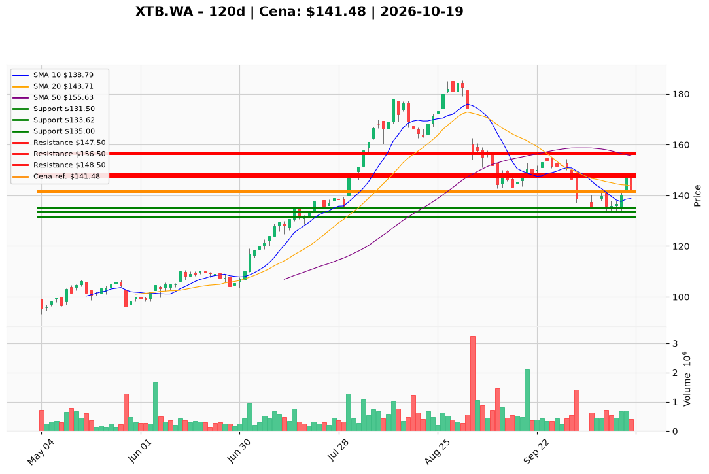

# XTB.WA — Ticket posiadacza (2026-10-19)

**Werdykt:** HOLD
**Horyzont:** pozycja (tygodnie–miesiące)
**Cena ref.:** 141,48 PLN

**Pozycja zapisana (XTB.WA#3):** wejście **141,00 PLN**; SL **131,50** / TP1 **147,50** / TP2 **156,50** PLN (zgodne z PM).
P/L vs 141,48: **+0,48 PLN (+0,3%)**. Piątek 16 X testował **147,82** (strefa TP1) i cofnął się — poniedziałek 19 X zamyka na 10 EMA (~141); histogram MACD **+0,77** (naprawa momentum), nadal **~9% pod SMA 50** (155,63).

| | Poziom | Uwagi |
|---|--------|------|
| **Akcja teraz** | Trzymaj całość | PM Hold; zero dokupu poniżej 150,00 |
| **Stop-loss** | **131,50 PLN** | twardy — zamknięcie dzienne <131,50 przy wolumenie >700k → EXIT |
| **TP1** | **147,50 PLN** | redukcja ~25% przy ponownym teście strefy 147–148 (vol >500k) |
| **TP2** | **156,50 PLN** | wyjście reszty przy SMA 50 |

**Sizing / skala:** Pełny lot #3 bez zmian @ 141,48. Przy TP1 sprzedaj ~25%. Reszta ze SL 131,50 do TP2 156,50. Zero nowego kapitału poniżej 150,00.

**Warunek dokupu:** Brak. ADD zablokowany do zamknięcia dziennego **>150,00** z rosnącym histogramem MACD i wolumenem >600k.

**Unieważnienie / pełne wyjście:** Zamknięcie dzienne **<131,50 PLN** przy wolumenie >700k → spłaszcz całość. Zamknięcie **>156,50** z naprawą trendu → oceń ADD osobno.

**Dlaczego (1–2 zdania):** Lot przy wejściu 141 PLN jest na zero po korekcie październikowej; fundamenty (P/E ~13×, ROE ~58%, ~620k kont/rok) i news produktowy uzasadniają cierpliwość, ale nieudane utrzymanie 147,82 i opinia PKO o korekcie wymagają trzymania ze SL pod dołkiem 133,62 — bez dokupu w dziurze pod SMA 50.

**WERDYKT KOŃCOWY:** **HOLD** — trzymaj XTB.WA#3 @ 141,48 (wejście 141,00; P/L +0,3%); skaluj ~25% przy TP1 **147,50** / reszta do TP2 **156,50** PLN; SL **131,50** PLN.

