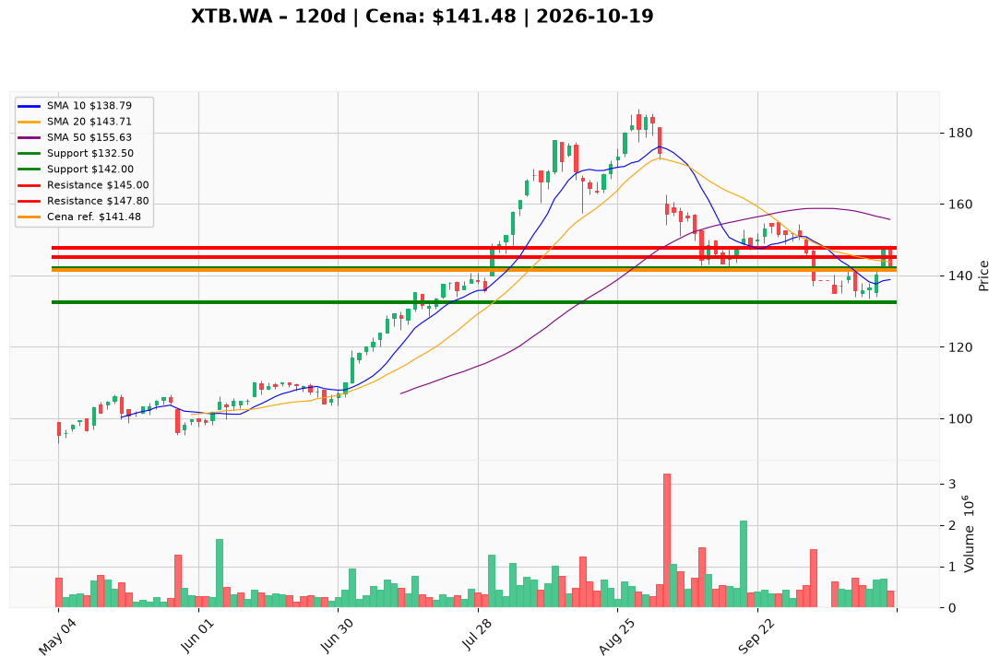

# XTB.WA — Ticket posiadacza (2026-10-19)

**Werdykt:** REDUCE  
**Horyzont:** pozycja (tygodnie–miesiące)  
**Cena ref.:** 141,48 PLN  

**Pozycja zapisana:** wejście 146,88 PLN (lot XTB.WA#2); wcześniejszy SL 142,0 PLN — **przekroczony** przy obecnej cenie. PM/Trader ustawiają twardy SL na 132,50 PLN.  
**P/L vs wejście:** ok. **−3,7%** (141,48 vs 146,88).

| | Poziom | Uwagi |
|---|--------|------|
| **Akcja teraz** | Redukcja **25–33%** @ market | PM Underweight: odciążenie taktyczne, dopóki dzienne zamknięcia są poniżej środka Bollingera (~144) i spadającej SMA50 (~155,6); bez dokupów pełnej skali |
| **Stop-loss** | **132,50 PLN** | twardy — poniżej październikowej podpory i ~1,5× ATR; reszta pozycji do wyjścia przy zamknięciu poniżej 133 na rosnącym wolumenie |
| **TP1** | **145,00 PLN** | redukcja kolejnej części (~25%) w strefie mean-reversion / środek BB |
| **TP2** | **147,80 PLN** | sprzedaż reszty taktycznej nadwyżki przy październikowym oporze 146–148; długoterminowe cele 157,5 / 172,0 **wstrzymane** do potwierdzenia stabilizacji (hold powyżej 144, potem 148) |

**Sizing / skala:** Po redukcji zostaw rdzeń pozycji z ryzykiem max **1,0% kapitału** do SL 132,50 od bieżącej wielkości; nie zwiększaj ekspozycji pod 144 PLN.

**Warunek dokupu:** brak (PM Underweight) — ewentualny dokup tylko po **trzech** sesjach zamknięć powyżej **148,00 PLN** z lepszym wolumenem na dniach wzrostowych.

**Unieważnienie / pełne wyjście:** Zamknięcie dzienne **< 133,00 PLN** na rosnącym wolumenie → **EXIT** reszty i brak nowych longów (ścieżka 125–120). Pełne przywrócenie sizingu pozycyjnego tylko po regułach invalidation powyżej 148.

**Dlaczego (1–2 zdania):** Jakość fundamentalna XTB pozostaje wysoka, ale cena jest w trendzie spadkowym, a 19.10 cofnął odbicie z 16.10 — PM i Trader zbiegają się w zarządzaniu ryzykiem zamiast łapania dołków. Przy wejściu 146,88 sensowne jest odchudzenie i ściśnięcie SL do 132,50, a nie trzymanie starego 142 bez reakcji.

**WERDYKT KOŃCOWY:** **REDUCE** — sprzedaj ok. 25–33% teraz, ustaw SL **132,50 PLN**, realizuj częściowo przy **145** i **147,80**; trzymaj rdzeń tylko z zdefiniowanym ryzykiem, bez dokupów do reclaimu **144+** (docelowo **148+** dla ponownej oceny celów 157,5 / 172,0).

