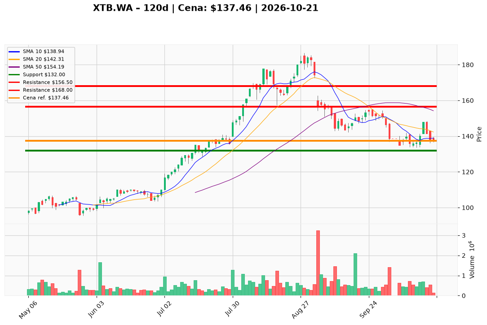

# XTB.WA — Ticket posiadacza (2026-10-21)

**Werdykt:** HOLD  
**Horyzont:** pozycja (tygodnie–miesiące)  
**Cena ref.:** 137,46 PLN  

**Pozycja zapisana:** wejście **164,00 PLN**, SL **132,00 PLN**, TP1 **156,50 PLN**, TP2 **168,00 PLN** (lot XTB.WA).  
**P/L vs wejście:** ok. **−16,2%** (137,46 vs 164,00).

| | Poziom | Uwagi |
|---|--------|------|
| **Akcja teraz** | **Trzymaj** — bez dokupów @ market | PM Hold: cena testuje październikowy dołek 133–137; brak nowej ekspozycji poniżej **144 PLN** |
| **Stop-loss** | **132,00 PLN** | twardy — poniżej półki wsparcia i strefy BB; przy zamknięciu dziennego **< 132** na rosnącym wolumenie → EXIT reszty |
| **TP1** | **156,50 PLN** | redukcja części przy odbiciu w stronę spadającej SMA50 |
| **TP2** | **168,00 PLN** | wyjście / realizacja reszty przy naprawie trendu |

**Sizing / skala:** Utrzymaj obecną wielkość lotu; ryzyko do SL 132 max **~1% kapitału** od bieżącej pozycji. Bez zwiększania pozycji pod **144 PLN**.

**Warunek dokupu:** brak przy HOLD — ewentualny dokup tylko po **trzech** sesjach zamknięć powyżej **148,00 PLN** z lepszym wolumenem na dniach wzrostowych.

**Unieważnienie / pełne wyjście:** Zamknięcie dzienne **< 132,00 PLN** na rosnącym wolumenie → **EXIT** całości. Pełna ponowna ocena celów po reclaimie **148+**.

**Dlaczego (1–2 zdania):** Fundamenty XTB nadal uzasadniają trzymanie rdzenia, ale technika pozostaje słaba (poniżej SMA50 i środka Bollingera); przy cenie na wsparciu PM wybiera zarządzanie ryzykiem z SL 132 zamiast dokupu lub panicznej redukcji.

**WERDYKT KOŃCOWY:** **HOLD** — trzymaj lot z wejścia 164 PLN, honoruj SL **132 PLN**, realizuj cele **156,50** i **168,00 PLN** przy odbiciu; bez dokupów do potwierdzenia **144–148 PLN**.

