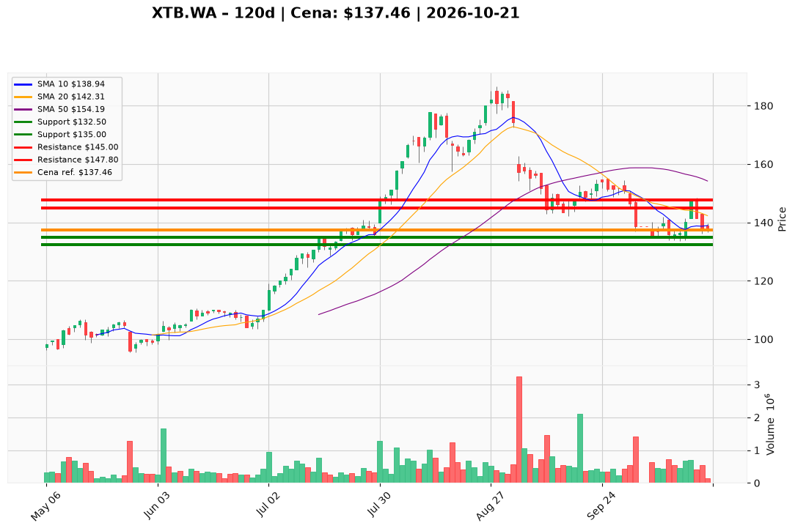

# XTB.WA — Ticket posiadacza (2026-10-21)

**Werdykt:** HOLD  
**Horyzont:** pozycja (tygodnie–miesiące)  
**Cena ref.:** 137,46 PLN  

**Pozycja zapisana (lot XTB.WA#2):** wejście **146,88 PLN** → P/L ok. **-6,4%** vs cena ref.

| | Poziom | Uwagi |
|---|--------|------|
| **Akcja teraz** | Trzymaj | Bez dokupu przy cenie rynkowej |
| **Stop-loss** | 132,50 PLN | twardy — zamknięcie dzienne poniżej |
| **TP1** | 145,00 PLN | redukcja części (ok. 30–40%) |
| **TP2** | 147,80 PLN | wyjście z reszty w strefie szczytu z 16.10 |

**Sizing / skala:** Utrzymaj pełny lot; nie dokładaj kapitału dopóki kurs nie zamknie się **powyżej 140 PLN** z sensownym wolumenem.  
**Warunek dokupu** (jeśli ADD): Zamknięcie **> 140 PLN** + utrzymanie 10 EMA; wtedy ewentualnie **+25%** pozycji, SL bez zmian.  
**Unieważnienie / pełne wyjście:** Zamknięcie dzienne **< 132,50 PLN** — wyjście zgodnie ze stop-em (kolejny support ~129 PLN).

**Dlaczego (1–2 zdania):** Broker wysokiej jakości (ROE ~58%, P/E TTM ~13) po korekcie technicznej poniżej SMA50, ale nadal w długim trendzie wzrostowym; PM i trader rekomendują cierpliwość z zdefiniowanym ryzykiem zamiast dokupu w spadającym krótkim terminie.

**WERDYKT KOŃCOWY:** **TRZYMAJ** pozycję z SL **132,50 PLN**, cele **145 / 147,80 PLN**; dokup tylko po przełamaniu **140 PLN**.

