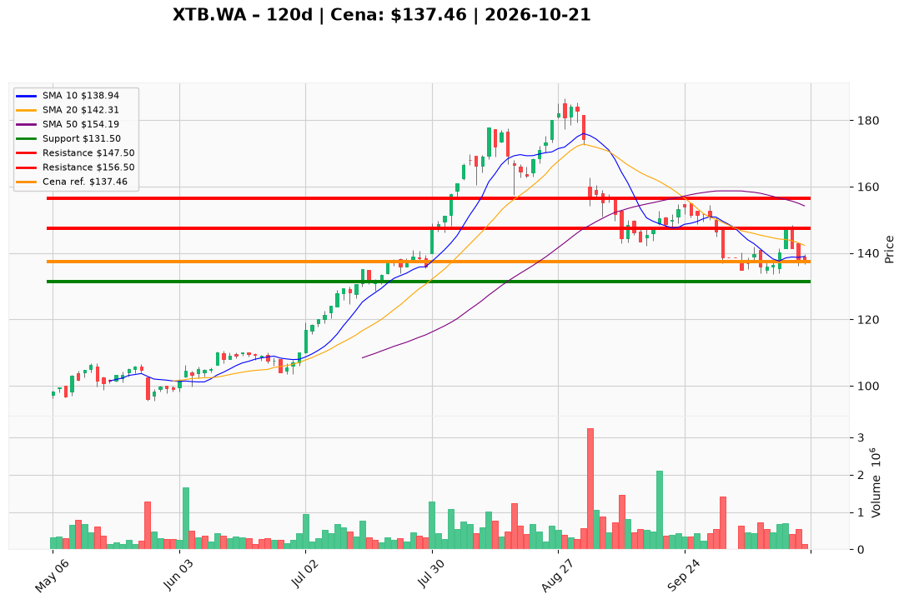

# XTB.WA — Ticket posiadacza (2026-10-21)

**Werdykt:** HOLD  
**Horyzont:** pozycja (tygodnie–miesiące)  
**Cena ref.:** 137,46 PLN  

**Pozycja zapisana (lot XTB.WA#3):** wejście **141,00 PLN** | P/L ok. **-2,5%** vs cena ref.

| | Poziom | Uwagi |
|---|--------|------|
| **Akcja teraz** | Trzymaj | Bez dokupu przy rynku — czekaj na potwierdzenie |
| **Stop-loss** | 131,50 PLN | twardy — poniżej strefy 133–136 |
| **TP1** | 147,50 PLN | redukcja części (~30–40%) przy powrocie do strefy breakout |
| **TP2** | 156,50 PLN | wyjście reszty / cel korekty w kierunku SMA50 |

**Sizing / skala:** Utrzymaj pełny lot; nie dokładaj kapitału dopóki dzienne zamknięcie nie przekroczy **147,50 PLN** z sensownym wolumenem.

**Warunek dokupu** (jeśli ADD): Zamknięcie dzienne **> 147,50 PLN**; dokup max. 25–30% obecnej ekspozycji, ten sam SL **131,50 PLN**.

**Unieważnienie / pełne wyjście:** Zamknięcie dzienne **< 131,50 PLN** → EXIT całości.

**Dlaczego (1–2 zdania):** XTB ma bardzo dobre wyniki (ROE, marże), ale wykres jest w korekcie poniżej SMA50 po nieudanym wybiciu 147,82 PLN; krótkoterminowo histogram MACD się stabilizuje, lecz dodawanie bez reclaim TP1 to nieuzasadnione ryzyko. PM: **Hold** z dotychczasowymi poziomami.

**WERDYKT KOŃCOWY:** **HOLD** — trzymaj pozycję z SL 131,50 PLN i celami 147,50 / 156,50 PLN; bez dokupu do przełamania TP1.

